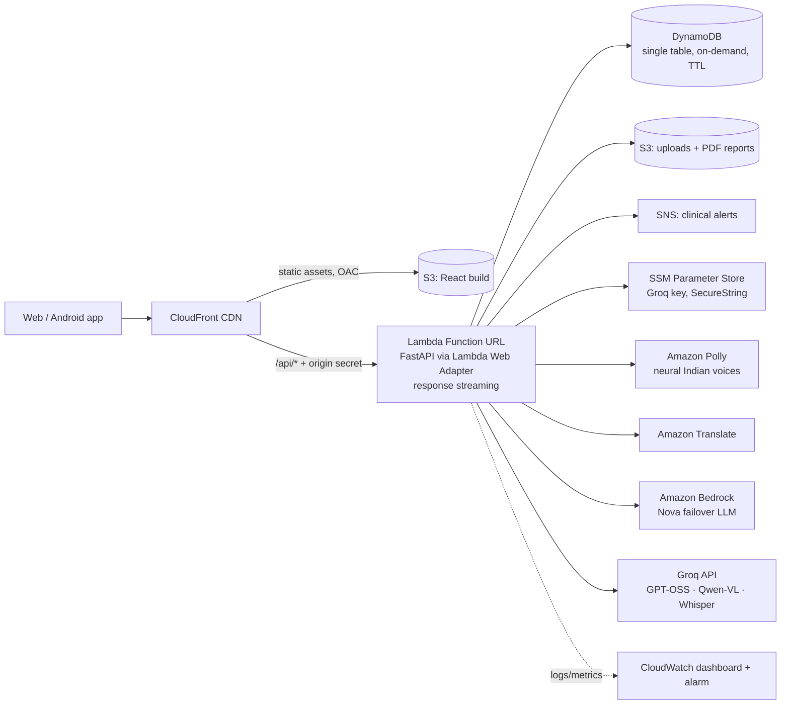

# 🏥 ClinIQ+: Clinical Intelligence Platform

[](https://aws.amazon.com)
[](https://vitejs.dev)
[](https://fastapi.tiangolo.com)
[](https://groq.com)

ClinIQ+ is a state-of-the-art, AI-powered physician co-pilot, patient engagement agent, and clinical decision support system (CDSS). It integrates advanced multimodal language models, visual pill scanners, real-time multilingual voice command systems, deterministic safety gates, and dynamic graph visualizations to streamline clinical workflows and improve patient safety.

---

## 🖥️ Primary Dashboard Overview

The ClinIQ+ Physician Dashboard serves as the command center for clinicians, providing real-time telemetry on patient queues, risk indices, alerts, scheduling timelines, and acute case tracking.

<p align="center">
  
</p>

---

## ⚡ Technical Innovation & Hackathon Highlights

ClinIQ+ represents an innovative integration of **probabilistic AI reasoning** and **deterministic safety frameworks** to solve core healthcare challenges:

### 1. Hybrid Deterministic-Probabilistic Safety Gate
* **The Problem**: LLMs in healthcare can suffer from hallucinations, which pose critical risks to patient safety.
* **The Innovation**: ClinIQ+ separates clinical reasoning from pharmacological validation. Vitals and drug-drug interactions are audited using a **rule-based, deterministic database engine** and standard medical dictionaries. The LLM acts as the orchestrator to parse unstructured inputs, but the safety check is mathematically verified against the database before any recommendation is rendered.

### 2. Multi-Agent LLM Orchestration
* Powered by **Groq** (GPT-OSS for reasoning and tool use, Qwen vision, Whisper speech) using native **Function Calling (Tool Use)**, with automatic per-model rate-limit failover and **Amazon Bedrock (Nova)** as a cross-cloud failover.
* Deconstructs complex, multi-intent queries (e.g., *"Check Patient Arjun's lab history, look for metformin contraindications, and print a summary"*) into a sequence of micro-actions, resolving dependencies dynamically.
* Implements robust error handling (e.g., missing vitals, invalid dosage maps, out-of-context requests) to gracefully degrade without crashing.

### 3. Server-Sent Events (SSE) Streaming Telemetry
* Implements real-time asynchronous streaming using FastAPI `StreamingResponse`, served end-to-end through **CloudFront → Lambda response streaming**.
* Streams clinical reasoning logs and missed dose impact simulations line-by-line, creating a highly responsive interface with sub-100ms latency.

### 4. Multilingual Vocal Translation Pipeline
* Translates local dialects (including Hindi, Tamil, Telugu, Malayalam, Kannada, Bengali, and Marathi) into clinical English on the fly.
* Generates localized audio playback using template-based voice engines, ensuring low latency and accessibility for regional demographics.

### 5. D3.js Force-Directed Comorbidity Web
* Implements dynamic disease-symptom relation graphs using **D3.js**.
* Translates patient diagnosis profiles into visual nodes, allowing clinicians to trace secondary risks and systemic connections interactively.

---

## 🚀 Key Feature Modules

### 1. Multimodal AI Intake Engine
Converts unstructured medical documentation (discharge summaries, laboratory reports, handwritten-style clinical notes) in PDF or image format into fully structured patient records. Vitals, demographics, active medications, and chronic conditions are parsed, validated, and instantly synchronized with the patient database.

| Document Upload Interface | Structured AI Case Review & Analytics |
| :---: | :---: |
|  |  |

---

### 2. PillGuard Scanner & Adherence Telemetry
Provides real-time validation of patient medication packages using vision AI.
* **Active Ingredient Extraction**: Identifies the chemical compounds of scanned packages.
* **Interaction Verification**: Automatically crosses the scanned chemical structure against the patient's existing regimen to identify contraindications.
* **Adherence Visualization**: Renders compliance calendars and streams clinical warnings on missed doses.

| PillGuard Dashboard | AI Ingredient & Adherence Analysis |
| :---: | :---: |
|  |  |

---

### 3. Patient Voice Assistant (Multilingual)
Allows patients to interact with their health records hands-free using natural vocal commands in regional Indian languages.
* **Symptom Logging**: Automatically converts spoken local language complaints into structured clinical alerts.
* **Medication Queries**: Explains drug purposes, side effects, and precautions in regional dialects.
* **Audio Feedback**: Generates real-time audio playback in the patient's language of choice.

<p align="center">
  
</p>

---

### 4. Professional PDF Case Sheet Generator
* Dynamically compiles patient profiles, biometric streams, adherence metrics, and clinical forecasts on the server side using the Python **ReportLab** library.
* Outputs publication-grade, multi-page PDF case summary files in real time for inter-departmental transfers or insurance verification.

---

## ☁️ Cloud Architecture (AWS, fully serverless)



| Concern | AWS design choice | Why |
| :--- | :--- | :--- |
| Compute | Lambda (arm64) + Lambda Web Adapter | Runs the unchanged FastAPI app; scales to zero; SSE streaming via response-stream mode |
| Edge | CloudFront with Origin Access Control | One HTTPS domain for site + API (no CORS); S3 bucket stays private |
| Data | DynamoDB single-table design | Patients, AI caches (native TTL expiry) and clinical logs in one on-demand table |
| Files | S3 (SSE, TLS-only, 30-day upload lifecycle) | Durable archive of intake documents, pill scans, audio and generated reports |
| Secrets | SSM Parameter Store SecureString | API key never in code or environment files |
| Resilience | Groq multi-model failover → Bedrock → offline clinical fallbacks | The demo never shows a blank panel |
| Security | Origin-verify header, least-privilege IAM role, private buckets | Function URL only usable through CloudFront |
| Cost | No NAT, load balancer or idle compute | ~$0 at demo traffic; whole stack removable with one command |
| IaC | AWS CDK (Python), `infra/` | Reproducible deploy / destroy |

### Stack Details
* **Frontend**: React 19, Vite, TailwindCSS, Zustand, Recharts, D3.js, GSAP, Three.js, Capacitor.
* **Backend**: FastAPI, Python 3.12, ReportLab, Matplotlib; storage is pluggable (`STORAGE_BACKEND=local` JSON/SQLite for laptops, `dynamodb` on AWS).
* **AI Engine**: Groq (`openai/gpt-oss-20b` primary with `gpt-oss-120b` / Qwen backups, `qwen/qwen3.8-27b` vision, `whisper-large-v3` speech); Amazon Bedrock Nova failover; Amazon Polly and Translate.
* **Cloud**: CloudFront, S3, Lambda, DynamoDB, SNS, SSM, CloudWatch, Polly, Translate, Bedrock, provisioned with AWS CDK.

---

## ⚙️ Quick Start

### Prerequisites
* Node.js (v18+)
* Python 3.10+
* Groq API key (free at console.groq.com)

### Backend Setup (FastAPI)
1. Navigate to the backend directory:
   ```bash
   cd cliniq-backend
   ```
2. Create a `.env` file and specify your Groq key:
   ```env
   GROQ_API_KEY=your_groq_api_key_here
   # optional: GROQ_TEXT_MODELS=openai/gpt-oss-20b,openai/gpt-oss-120b
   ```
3. Install dependencies:
   ```bash
   pip install -r requirements.txt
   ```
4. Run the development backend:
   ```bash
   python main.py
   ```
   *The API will run on http://localhost:8000*

### Frontend Setup (React + Vite)
1. Go to the project root and install Node modules:
   ```bash
   npm install
   ```
2. Start the Vite development server:
   ```bash
   npm run dev
   ```
   *The client will run on http://localhost:5173*

---

### Deploy to AWS
Prerequisites: AWS CLI profile `cliniq`, Node.js, [uv](https://docs.astral.sh/uv/). No Docker needed.
```bash
./infra/deploy.sh                                   # build, deploy, migrate data, print the site URL
ALERT_EMAIL=you@example.com ./infra/deploy.sh       # also email alerts + a $10 monthly budget
./infra/destroy.sh                                  # remove everything when finished
```
